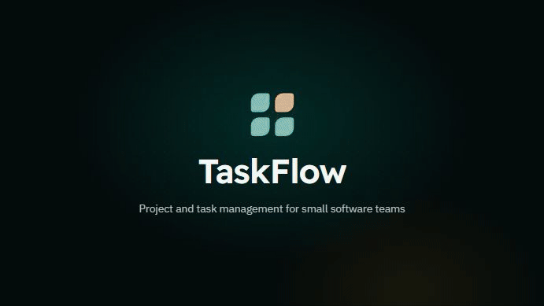
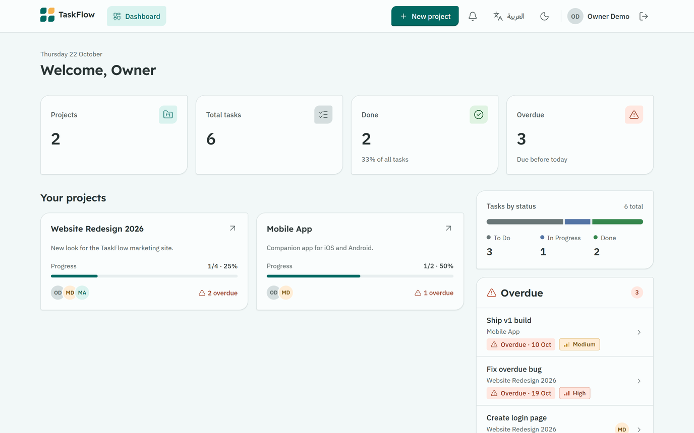
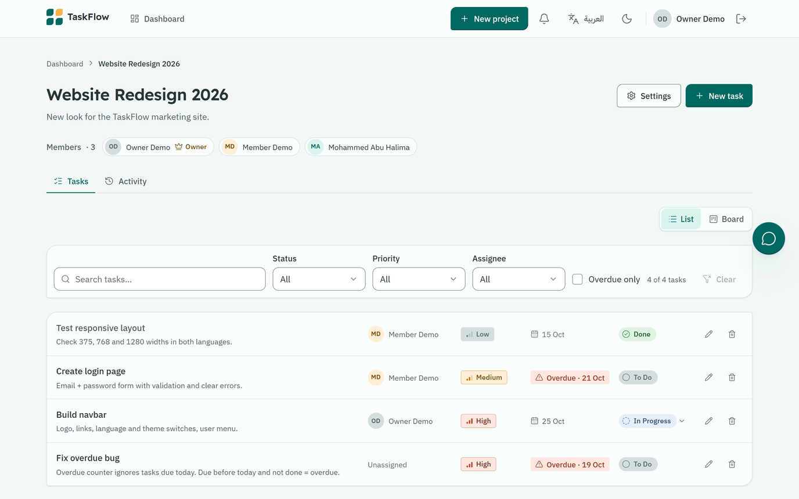
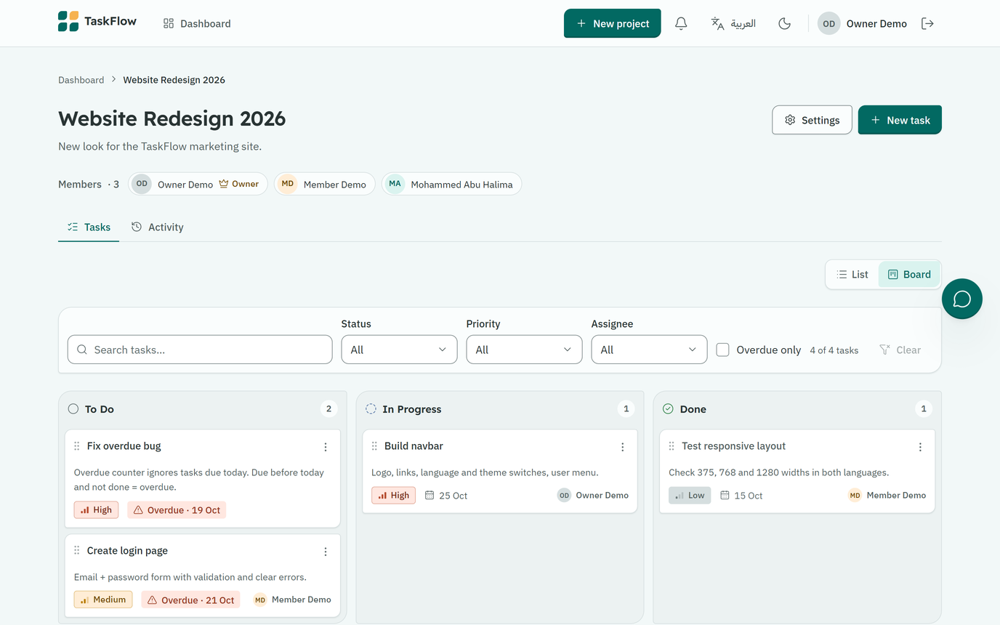
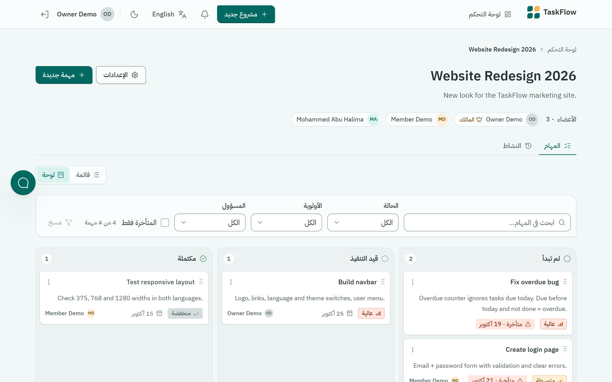
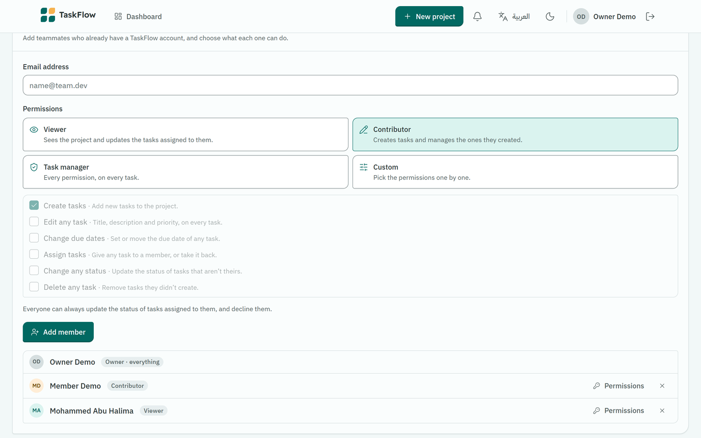
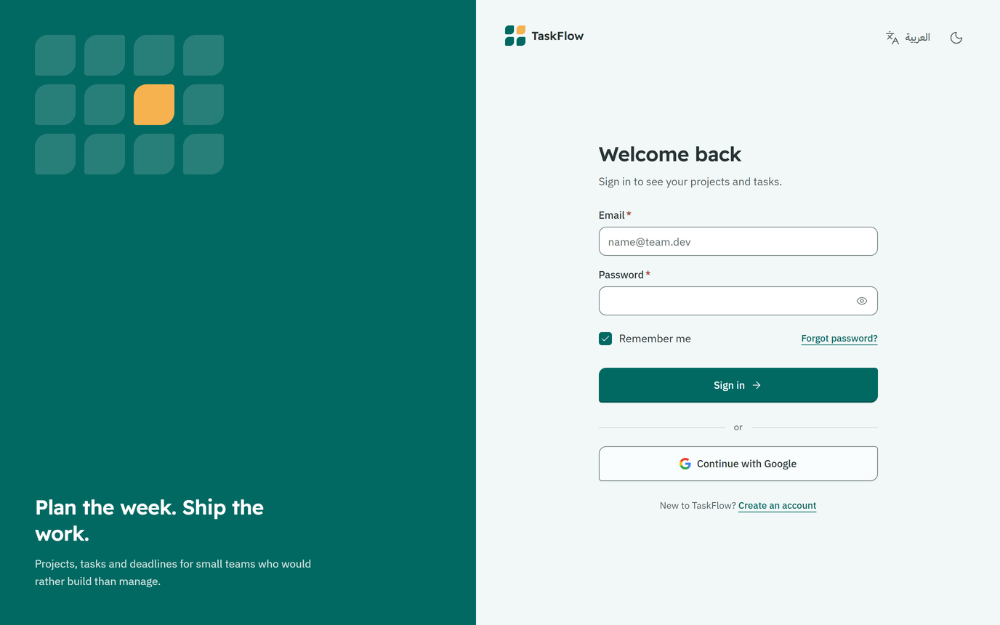
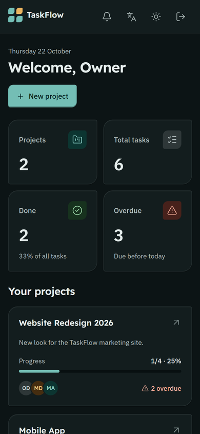
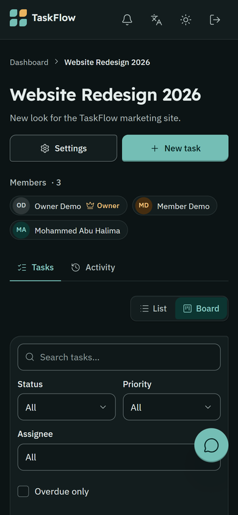
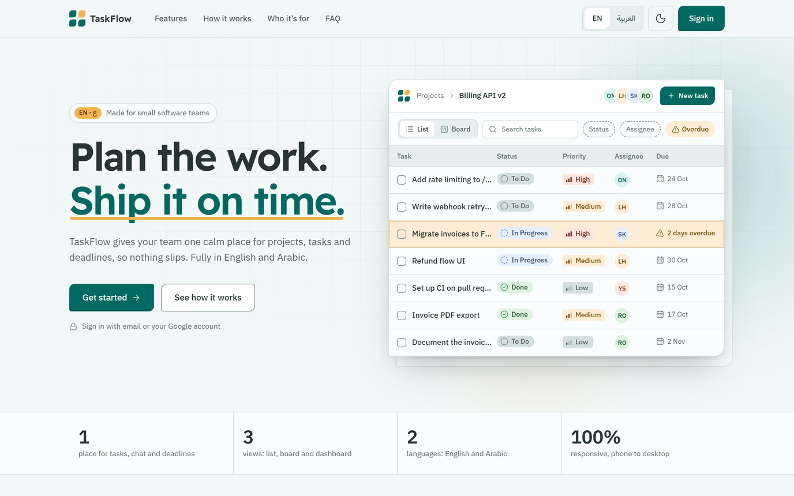

<div align="center">


# TaskFlow

**Project and task management for small software teams, in English and Arabic.**

[**Live demo**](https://taskflow-be3db.web.app) · [Features](#features) · [Run it locally](#run-it-locally) · [Security](#security)


</div>

---

## Watch the 30-second tour

<!-- Video: in the GitHub web editor, drag video/out/github/taskflow-en.mp4 onto the empty line below. -->


<details>
<summary><b>Arabic version</b></summary>

<!-- Video: drag video/out/github/taskflow-ar.mp4 onto the empty line below. -->


</details>

<p align="center">
  <a href="https://taskflow-be3db.web.app"></a>
</p>

## About

TaskFlow gives a small team one calm place for projects, tasks and deadlines. Owners create projects and
invite teammates by email, everyone sees who is doing what and what is late, and work moves across a
Kanban board. The whole interface works in English (left to right) and Arabic (right to left), in light
and dark themes, from a phone up to a wide desktop.

It was built in 7 days for the TAQAT / CodeMap full-stack challenge. There is no custom backend: the
React app talks to Firebase directly, and every permission is enforced by Firestore Security Rules, with
an automated test suite to prove it.

## Features

**Projects and tasks**
- Create, edit and delete projects (name 3–80 characters, optional description).
- Tasks with title, description, status (To Do, In Progress, Done), priority, assignee and due date.
- **List or Kanban board**: drag cards between columns with the mouse, touch or keyboard, with Undo.
  Every card also has a "Move to" menu.
- Search by title and filter by status, priority, assignee and **Overdue only**. Filters combine.

**Dashboard**
- Stat cards: projects, total tasks, done, overdue.
- Tasks by status, a list of every overdue task across your projects, and progress per project.
- Overdue means the due date is before today and the task is not done. "Today" is calculated in the
  team's time zone (Asia/Hebron), not UTC.

**Teamwork**
- Add members by email and pick what they can do: Viewer, Contributor, Task manager or a custom set
  (create, edit, due dates, assign, status, delete).
- Status updates from assignees, with an optional message to the owner.
- In-app notifications (assigned, status changed, declined) and an owner-only activity log.
- Project chat with unread badges and "seen" ticks.
- Removing a member revokes their access right away and unassigns their tasks.

**Experience**
- Full English and Arabic interface, with right-to-left layout in Arabic (Western digits in both).
- Light and dark themes, remembered per browser.
- Responsive from 375px phones to wide screens.
- Accessible: keyboard navigation, visible focus, skip link, screen-reader announcements on the board,
  and status or priority never shown by colour alone.
- Sign in with email and password or Google, with Remember me and password reset.
- Clear errors when offline (nothing is saved half-way), and a landing page for visitors.

## Screenshots

| Dashboard | Task list |
|---|---|
|  |  |
| **Kanban board** | **Kanban board in Arabic (RTL)** |
|  |  |
| **Members and permissions** | **Sign in** |
|  |  |

<p align="center">
  
  &nbsp;&nbsp;
  
</p>

<details>
<summary>Landing page</summary>



</details>

## Tech stack

| Area | Choice |
|---|---|
| UI | React 19, Vite 8, React Router 7 |
| Styling | Tailwind CSS 4 (CSS-first `@theme`), a custom design system with semantic colour tokens |
| Data and auth | Firebase Authentication (email/password, Google) and Cloud Firestore |
| Security | Firestore Security Rules, tested with `@firebase/rules-unit-testing` on the emulator |
| Components | Radix UI (Select, Popover, Direction), react-day-picker, date-fns, @dnd-kit, lucide-react |
| Fonts | IBM Plex Sans, IBM Plex Sans Arabic, Readex Pro |
| Hosting | Firebase Hosting |

## Run it locally

You need Node.js 20.19+ (or 22.12+) and a Firebase project with **Authentication** (Email/Password, and Google
if you want it) and **Cloud Firestore** turned on.

```bash
git clone https://github.com/eng-mohammed-abuhalima/TaskFlow.git
cd TaskFlow
npm install
cp .env.example .env.local   # then fill in the values (see below)
npm run dev                  # http://localhost:5173
```

### Environment variables

Copy the web app config from Firebase Console (Project settings > Your apps) into `.env.local`.
This file is git-ignored. The Firebase web config identifies the project, it is not a secret: access is
controlled by the security rules.

| Variable | Where to find it |
|---|---|
| `VITE_FIREBASE_API_KEY` | `apiKey` |
| `VITE_FIREBASE_AUTH_DOMAIN` | `authDomain` |
| `VITE_FIREBASE_PROJECT_ID` | `projectId` |
| `VITE_FIREBASE_STORAGE_BUCKET` | `storageBucket` |
| `VITE_FIREBASE_MESSAGING_SENDER_ID` | `messagingSenderId` |
| `VITE_FIREBASE_APP_ID` | `appId` |

### Scripts

| Command | What it does |
|---|---|
| `npm run dev` | Start the dev server |
| `npm run build` | Production build into `dist/` |
| `npm run lint` | ESLint |
| `npm run test:rules` | Run the security rules tests on the Firestore emulator (needs Java 21+) |
| `npm run test:rules:mutations` | Break the rules on purpose, 26 different ways, and check the tests catch every one |
| `npm run deploy:rules` | Deploy `firestore.rules` only |
| `npm run deploy` | Build and deploy the site to Firebase Hosting |
| `npm run deploy:all` | Build and deploy the site and the rules together |

## Firestore data model

```text
users/{uid}                         displayName, email, createdAt            (private to the user)
  notifications/{noteId}            type, projectId, taskId, actorId, at, read, ...   (only the recipient reads)
userEmails/{email}                  uid, displayName                         (lookup for "add member by email")
projects/{projectId}                name, description, ownerId, memberIds[], members{uid: {displayName}},
                                    createdAt, updatedAt
  tasks/{taskId}                    title, description, status, priority, assigneeId, createdBy,
                                    dueDate ("YYYY-MM-DD" or null), rank, createdAt, updatedAt
  memberPerms/{uid}                 perms[] (create, edit, dueDate, assign, status, delete)
  activity/{entryId}                who changed what and when                 (owner only)
  messages/{messageId}              text, authorId, authorName, createdAt     (project chat)
  chatReads/{uid}                   readAt                                    ("seen" ticks)
```

- `memberIds` always includes the owner. `members` mirrors it with display names, so members can see
  each other's names without reading private profiles.
- The dashboard loads the projects you belong to and their tasks, then counts on the client (no
  collection-group queries).
- Timestamps are server times (`serverTimestamp()`); the rules reject anything else.

## Security

With no backend, **Firestore Security Rules are the only enforcement**. Hiding a button in the UI is never
treated as protection; every permission in `src/lib/permissions.js` mirrors a rule.

| | Outsider | Member | Owner |
|---|---|---|---|
| See the project and its tasks | no | yes | yes |
| Create tasks | no | yes (by default) | yes |
| Edit or delete a task | no | tasks they created, or with permission | any |
| Change a task's status | no | tasks assigned to them, or with permission | any |
| Edit or delete the project, manage members | no | no | yes |

Highlights:
- Deny by default, then each path is opened narrowly.
- Every write is validated: allowed fields, types, lengths, status and priority values, real dates.
- Fields such as `ownerId`, `createdBy` and `createdAt` can never change.
- Activity entries and notifications must be written in the same batch as the change they describe, and
  the rules check that they match it.
- Emails can't be listed or dumped; a lookup returns one user at a time.

The rules are covered by **298 tests** on the emulator, and a mutation check breaks the rules in 26
different ways to prove the tests fail each time. The full table, every hardening decision and the known
limits are in [docs/SECURITY.md](docs/SECURITY.md).

## Project structure

```text
src/
  pages/          one file per route (Dashboard, ProjectDetails, ProjectSettings, Login, ...)
  components/     UI building blocks; board/, chat/, dashboard/, landing/, notifications/, activity/
  services/       every Firestore read and write (projects, tasks, members, chat, ...)
  hooks/          live data (useProject, useTasks, useDashboard, useChat, ...)
  context/        auth, preferences (language and theme), toasts
  lib/            pure helpers: filters, stats, permissions, ranks, dates, validation
firestore.rules   the security rules
tests/            rules tests and the mutation check
docs/             design system, security notes, roadmap, screenshots
video/            the promo video (Remotion), see video/README.md
```

## Known limits

- The dashboard counts tasks in the browser, so it reads every task of every project you are in. That is
  fine for small teams but would need server-side counters at a larger scale.
- A project has at most 20 members.
- Offline changes are refused with a clear message rather than queued.
- Notifications are in-app only (no email or push).
- Deleting a project removes its tasks, chat and log from the browser in batches; there is no server
  function doing it.
- Chat messages can be deleted but not edited.

## Author

**Mohammed Abu Halima** · built for the TAQAT / CodeMap 7-day full-stack challenge.
